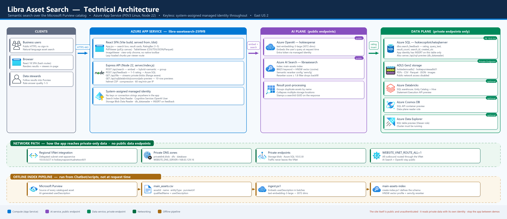

# Libra Asset Search

> Natural-language search across the Microsoft Purview data catalog — ask for what you
> *mean*, not the exact table name.

Project Libra uses AI to write rich descriptions for every catalogued asset. This app makes
those descriptions **searchable by meaning**: it embeds your question, runs a hybrid
keyword + vector query against Azure AI Search, reranks semantically, and links each result
straight back to Purview. Storage-backed assets can be previewed in the browser without
downloading them, and SQL / Databricks / Cosmos / ADX tables get a 10-row peek.

This standalone repository contains the chatbot from
[Project Libra](https://github.com/ujvalgandhi1/ProjectLibra). It includes source code,
tests, and deployment tooling, not installed dependencies, build output, catalog data,
or local deployment state. Publishing this repository does not deploy a running Azure app.

---

## Architecture



Regenerate the diagram with:

```powershell
pip install diagrams pillow
python architecture\generate-diagram.py
```

The design in one line: **a public, unauthenticated web app that reads private data using
its own managed identity.** There are no keys or connection strings anywhere in the source
— every downstream call (AI Search, Azure OpenAI, Storage, SQL, Cosmos, ADX, Databricks)
authenticates with `DefaultAzureCredential`.

| Plane | Reached how |
|---|---|
| **AI** — Azure AI Search, Azure OpenAI | Public endpoints, Entra token from the app identity |
| **Data** — ADLS Gen2, Azure SQL, Cosmos, ADX | **Private endpoints only**, via regional VNet integration |
| **Indexing** — Azure AI Search → ADLS Gen2 | **Shared private link**, using the search service's own managed identity |

New customer deployment? Start with **[PROVISIONING.md](PROVISIONING.md)** for the resources,
tiers and permissions you need before running anything.

---

## What it does

| Feature | Notes |
|---|---|
| **Semantic asset search** | Hybrid BM25 + 3072-dim vector search, then a semantic reranker |
| **Catalog browse** | An empty query lists the whole catalog with true index-wide facet counts — see [Search and browse](#search-and-browse) |
| **Faceted refinement** | Collection, platform, entity type, format, owner and expert — every one is an indexed, facetable field |
| **Stewardship gap facets** | Filter *for* assets with no owner or no expert, which the Purview catalog can't do |
| **Preview pane** | The file, table or document renders beside the results instead of taking over a new tab |
| **Result grouping** | The same document catalogued in several storage accounts collapses into one row listing every location |
| **Relevance filtering** | Vector search always backfills to `top`; results below reranker score `1.8` are dropped |
| **View-only PDF viewer** | Custom pdf.js canvas renderer — no native toolbar |
| **Table viewer** | CSV, TSV, JSON and Parquet rendered in-page with sort + filter (10-row preview) |
| **Image viewer** | Zoom / pan / fit for PNG, JPEG, GIF, WebP, BMP |
| **Database previews** | `SELECT TOP 10` against Azure SQL, Synapse, Databricks, Cosmos and ADX |
| **Bulk export** | Download the current result set as CSV, one row per catalogued location |
| **Search ratings** | A 1–5 usefulness scale below the results, persisted to Azure SQL |
| **Most common searches** | The suggestion chips are ranked from the real query log, not hand-written |

---

## Search and browse

There is one search box and no mode switch. What you type decides which query runs, under a
single rule: **facets always describe the set you are currently looking at.**

| Query box | The set is | Facet counts come from |
|---|---|---|
| empty | the whole catalog, minus filters | the index — `POST /api/browse` |
| has text | the relevance-ranked results | the rows in the browser |

Browsing is what the app opens on, so the landing page is the catalog rather than an empty
prompt. Clearing the box turns the button into **Browse all**.

The two paths are genuinely different queries, not one query with a flag:

| | Search | Browse |
|---|---|---|
| Query | semantic + vector | `search: *`, `queryType: simple` |
| Ranking | reranker, cut-off `1.8` | none — server-side `orderby` |
| Filtering | in the browser | OData `filter` on the index |
| Paging | none, capped at 50 | `skip` / `top`, 50 per page |
| Duplicates | grouped by name | left intact — an inventory should show every row |
| Logged to `dbo.search_log` | yes | no |

**A wildcard `*` in the search box does not work, by design.** The semantic ranker has no
query text to rank against, so it returns no `rerankerScore`; the score falls back to a flat
`@search.score` of `1.0`, which is below the `1.8` cut-off, and every row is discarded. Browse
exists precisely because "show me everything" is a filter-and-count problem, not a relevance
one.

### Why browse costs more than one query

A single query would return facet counts *within* the current filter, so choosing one
collection would hide every other collection and you could not switch without clearing first.
To avoid that, each group that has a selection is counted again with **its own filter
excluded**. The cost is one extra request per selected group — normally zero or one, not one
per facet.

Two consequences worth knowing:

- **Stewardship needs its own count.** The `owner` and `expert` facets give "no owner" and
  "no expert" separately, but never their intersection, so "no owner or expert" is a
  separate `count`-only query.
- **Every facet must be a real field.** `format` used to be derived from the path while
  rendering, which worked for search (all the rows are in the browser) but not for browse
  (the index can't count a field it doesn't store). It is now computed once in
  `to-jsonl.py` and indexed, so both modes read the same value.

---

## How a search actually works

1. The browser posts your question to `POST /api/search`.
2. The server embeds it with **Azure OpenAI** (`text-embedding-3-large`, 3072 dims).
3. It sends a **hybrid** query to `main-assets-index` — BM25 over `name` / `userDescription`
   plus a `descriptionVector` kNN query (HNSW, cosine) — with `queryType: semantic` and the
   `semcfg` reranker configuration.
4. Results scoring below `SEARCH_MIN_RERANKER_SCORE` (default `1.8` on a 0–4 scale) are
   discarded. This matters: vector search *always* returns `top` neighbours, so without the
   cut-off a narrow query silently backfills with loosely-related assets.
5. Remaining hits are grouped by asset name so one document catalogued in multiple
   locations renders as a single row.
6. The response carries a **`searchId` GUID**, echoed back with any rating so feedback ties
   to that exact result set.
7. The query is written to `dbo.search_log` **after the response is sent** — fire-and-forget,
   so telemetry can never slow down or fail a search.

Nothing crawls Purview at request time. The index is populated ahead of time — see
[Loading the index](#loading-the-index).

---

## Search ratings

After each search the UI shows a 1–5 scale. `POST /api/feedback` inserts one row into
**`dbo.search_feedback`** on the existing Azure SQL database, reached over the same private
endpoint and managed identity as the table previews.

| Column | Notes |
|---|---|
| `feedback_id` | identity PK |
| `created_utc` | `DATETIME2(3)`, defaults to `SYSUTCDATETIME()` |
| `rating` | `TINYINT`, `CHECK (rating BETWEEN 1 AND 5)` |
| `query_text` | `NVARCHAR(1000)` |
| `result_count` | how many matches were on screen |
| `search_id` | correlates the rating to one specific result set |

The app identity is granted **`INSERT` on this table only** — not `db_datawriter`, which
would allow writes to every table in a shared database. Reading ratings back is done as
yourself:

```sql
SELECT TOP 50 * FROM dbo.search_feedback ORDER BY created_utc DESC;
SELECT rating, COUNT(*) AS n FROM dbo.search_feedback GROUP BY rating ORDER BY rating;
```

---

## Most common searches

The chips under the search box used to be a hard-coded list. They are now ranked from
what people actually search for.

Every `/api/search` writes one row to **`dbo.search_log`** (same database, same private
endpoint, same managed identity as the ratings table):

| Column | Notes |
|---|---|
| `log_id` | identity PK |
| `created_utc` | `DATETIME2(3)`, defaults to `SYSUTCDATETIME()` |
| `search_id` | correlates the query to its result set and any rating |
| `query_text` | `NVARCHAR(1000)`, exactly what was typed |
| `query_norm` | `NVARCHAR(200)`, the cleaned-up grouping key |
| `result_count` | how many matches came back |

**Cleaning up.** `query_norm` is computed in the server before insert: lowercased, smart
quotes folded, everything except letters / digits / spaces / apostrophes / hyphens
replaced with a space, runs of whitespace collapsed. So `Sales Order Data!!`,
`sales order data` and `  SALES   ORDER   DATA ` all rank as one entry instead of three.

`GET /api/popular-searches` then returns the top few, with deliberate filters:

- **at least `POPULAR_MIN_HITS` occurrences** (default `3`) — one person's typo never
  reaches the landing page
- **`result_count > 0`** — never advertise a query that finds nothing
- **8–80 characters** — drops `a`, `test`, and pasted walls of text
- **last `POPULAR_WINDOW_DAYS`** (default `90`) — the list reflects current interest
- results are **cached in memory for `POPULAR_CACHE_SECONDS`** (default `300`), so page
  loads don't each cost a SQL round trip

If the log is empty, unprovisioned or unreachable, the endpoint returns `{ items: [] }` and
the client silently falls back to the curated `FALLBACK_EXAMPLES` in `App.jsx` under the
original **Try:** label. Nothing breaks before the log has traffic.

Turn logging off entirely with `SEARCH_LOG_ENABLED=false`. The server also disables it
automatically after a missing-table or missing-grant error, rather than retrying a doomed
connection on every search.

Inspect the log as yourself:

```sql
SELECT TOP 50 * FROM dbo.search_log ORDER BY created_utc DESC;

SELECT query_norm, COUNT(*) AS hits, MAX(created_utc) AS last_seen
FROM dbo.search_log
WHERE result_count > 0
GROUP BY query_norm
HAVING COUNT(*) >= 3
ORDER BY hits DESC;
```

---

## Repository layout

```
LibraChatBot/
├── app/
│   ├── client/            React 18 SPA (Vite)
│   │   ├── App.jsx        workbench shell: facet rail, result list, preview pane, export
│   │   ├── PdfViewer.jsx  view-only pdf.js canvas renderer
│   │   ├── TableViewer.jsx  CSV/TSV/JSON/Parquet + DB previews
│   │   ├── ImageViewer.jsx
│   │   └── styles.css
│   ├── public/logo.png    header logo + favicon (swap to rebrand)
│   └── server/index.js    Express API (single file)
├── architecture/          diagram + generator
├── infra/                 numbered provisioning scripts (see infra/README.md)
├── Mockups/               static UI design prototypes (not deployed)
├── scripts/               index schema, JSONL conversion, probes
├── out/                   generated JSONL (git-ignored)
├── PROVISIONING.md        what a customer needs to provision
└── main_assets.csv        local Purview export that seeds the index (not committed)
```

The three viewers are shared components. They render full-page at `#/view`, `#/table` and
`#/image`, and inline inside the preview pane when given a `src` prop.

---

## Local development

Requires **Node 20+** and `az login` (the server authenticates as you locally).

Clone the repository and install the locked dependencies once:

```powershell
git clone https://github.com/ujvalgandhi1/LibraChatBot.git
npm --prefix ".\LibraChatBot\app" ci
az login
```

In the commands below, `<repo>` is the absolute path to your `LibraChatBot` checkout.
The Azure subscription and the configured AI Search and Azure OpenAI services must be
active; starting the local servers does not start or provision those services. Reference
deployment values in `app/server/config.js` can be overridden with environment variables.

```powershell
# Terminal 1 — Express API on :8080
npm --prefix "<repo>\app" start

# Terminal 2 — Vite dev server on :5173 (hot reload, proxies /api to :8080)
npm --prefix "<repo>\app" run dev
```

Open <http://localhost:5173>.

Use `--prefix` rather than `cd` — some shells drop the `cd` and you get a
"Cannot find module" error.

**The API server has no hot reload.** Restart terminal 1 after editing `server/index.js`.
The client *does* hot reload through Vite.

### Tests

```powershell
npm --prefix "<repo>\app" test
```

Node's built-in runner — no test dependencies. The suites in `app/server/test/` cover the
pure, security-critical functions in `app/server/lib/`: the `qualifiedName` parsers and their
SSRF guards, identifier quoting for T-SQL / Spark SQL / KQL, OData filter construction, query
normalisation, and rate-limit accounting including counter eviction.

`app/client/test/format.test.js` covers `app/client/lib/asset-format.js` — the badge, pane
routing and format rules.

> Full coverage map — including **what is deliberately not tested** — is in
> [Project Libra's testing guide](https://github.com/ujvalgandhi1/ProjectLibra/blob/main/TESTING.md).

**The format rule is a cross-language contract.** `formatOf()` in the client and
`format_of()` in [scripts/to-jsonl.py](scripts/to-jsonl.py) must agree, or a row's badge and
the facet it falls under will disagree for the same asset. Both are pinned to the shared
fixtures in [scripts/format_fixtures.json](scripts/format_fixtures.json):

```powershell
npm --prefix "<repo>\app" test          # JS half
python "<repo>\scripts\test_to_jsonl.py" # Python half
```

Add a fixture whenever you change either implementation.

Single-server alternative (also exercises the production helmet CSP):

```powershell
npm --prefix "<repo>\app" run build
npm --prefix "<repo>\app" start   # everything on http://localhost:8080
```

### Reaching private data locally

Storage and SQL have **public network access disabled**, so off-VPN calls fail with a
network-level `403` — which looks like a permissions error but isn't. To exercise the file
viewer or any database preview locally, connect the VPN for your Azure VNet first.
The reference deployment uses the `hokiesynapse` P2S VPN; obtain its connection profile
from your environment administrator. VPN profiles are not included in this repository.

> ⚠️ If SQL-backed features fail locally while working in the cloud, check
> `C:\Windows\System32\drivers\etc\hosts` for a stale static entry overriding
> `hokiecopilotchatsqlserver.database.windows.net`. It should resolve to the private
> endpoint (`10.0.3.8`). Connecting by raw IP does **not** work — the Azure SQL gateway
> routes by server name.

---

## Branding

The header logo and the browser favicon both come from a single file:

```
app/public/logo.png
```

Anything in `app/public/` is served at the site root by Vite in dev and copied verbatim
into `dist/` at build time, so **swapping the logo is a file replacement — no code change.**

1. Overwrite `app/public/logo.png` with your own image.
2. Rebuild (`npm --prefix "<repo>\app" run build`) or restart `npm run dev`.
3. Redeploy with `infra/03-deploy.ps1` — `public/` is part of the deployment zip.

**Image guidance.** The header renders the logo at a fixed **34 px height** on a white
rounded badge, with width following the source aspect ratio up to **160 px**. A landscape
wordmark or a square mark both work; supply roughly 2–3× those pixel dimensions so it stays
crisp on high-DPI screens. PNG with transparency is ideal — the badge supplies a white
backdrop, so dark artwork reads well against the blue gradient.

**Using a different filename or format** (e.g. `acme-logo.svg`): drop it in `app/public/`
and update the two references —

| File | Reference |
|---|---|
| [app/index.html](app/index.html) | `<link rel="icon" href="/logo.png" />` |
| [app/client/App.jsx](app/client/App.jsx) | `` |

Size, padding and the white badge live in the `.brand-mark` rule in
[app/client/styles.css](app/client/styles.css); the surrounding gradient is the
`--brand` / `--accent` custom properties at the top of the same file. If your logo already
carries a light background, delete the `background`, `border-radius`, `padding` and
`box-shadow` lines from `.brand-mark` to let it sit flush in the header.

The app title and tagline beside the logo are plain text in `App.jsx`.

> The helmet CSP allows images from `'self'`, `data:` and `blob:` only. Hosting the logo on
> an external CDN will be blocked unless you add that origin to `imgSrc` in
> [app/server/index.js](app/server/index.js).

---

## Loading the index

Provide your own `main_assets.csv` export at the repository root before loading the index
or deriving catalog-based permissions and allowlists. Catalog exports and the generated
`out/` directory are intentionally excluded from source control.

The index is populated by an **Azure AI Search indexer** that pulls JSON Lines from ADLS
Gen2 and generates the embeddings itself. Nothing has to run from a laptop, and reruns only
process what changed.

```
main_assets.csv  ──to-jsonl.py──▶  <account>/main-assets/jsonl/*.jsonl
                                          │
                       indexer + AzureOpenAIEmbeddingSkill (every 12 h)
                                          ▼
                                   main-assets-index
```

**1. Create or update the index schema.**

```powershell
cd scripts
./create-index.ps1
```

This is a `PUT`, so adding fields is additive — no rebuild, no data loss. Changing an
*existing* field's attributes does force a rebuild, so add a new field instead.

**2. Convert the export to JSON Lines.**

```powershell
python to-jsonl.py                          # CSV → ../out/jsonl
python to-jsonl.py --source assets.parquet  # needs: pip install pyarrow
```

JSON Lines rather than CSV because `userDescription` is multi-line markdown containing
commas, quotes and newlines — one mis-escaped quote in a CSV silently shifts every column on
that row. The converter emits index field names directly (so the indexer needs no field
mappings), mirrors the key-sanitising rule from `ingest.ps1` (so reruns merge instead of
duplicating), and splits output at 8 MB to stay under the blob source-file cap.

It also precomputes two fields. `embedText` keeps the skillset to a single embedding skill:
adding a Shaper or Merge skill to assemble the text would push the indexer into the S1-only
bracket for private-link connections. `format` (`pdf`, `csv`, `sql`, `container`, …) is
derived from `qualifiedName` using the same rules as `formatOf()` in `app/client/App.jsx`
— **keep the two in step**, or the badge on a row and the facet it falls under will
disagree for the same asset.

**3. Upload and run.**

```powershell
az storage fs file upload -s ../out/jsonl/main_assets-001.jsonl `
  -p jsonl/main_assets-001.jsonl -f main-assets `
  --account-name <account> --auth-mode login --overwrite

cd ../infra
./10-blob-indexer.ps1 -Run
```

| Script | Purpose |
|---|---|
| `scripts/create-index.ps1` | Creates/updates `main-assets-index` — field schema, HNSW vector profile, `semcfg` semantic config |
| `scripts/to-jsonl.py` | CSV or Parquet → JSON Lines, split for the blob size cap |
| `infra/10-blob-indexer.ps1` | Data source, embedding skillset and indexer (`-Prepare` sets up RBAC and the private link) |
| `scripts/ingest.ps1` | Legacy push path. `-MetadataOnly` merges scalar columns without re-embedding — still the fastest way to correct a column |
| `scripts/search-test.ps1` | End-to-end query check without the web app |
| `scripts/_connutil.ps1` / `_inspectindex.ps1` / `_verifyindex.ps1` | Connectivity probes, index introspection, post-run verification |

---

## Deployment

Provisioning is a set of numbered scripts — see **[infra/README.md](infra/README.md)** for
the full table, prerequisites and demo operations.

```powershell
cd infra
./01-provision.ps1      # RG, P0V3 Linux plan, web app, managed identity
./02-rbac.ps1           # Search / OpenAI / Storage role assignments
./03-deploy.ps1         # zip deploy, Oryx builds vite server-side
./04-vnet.ps1           # regional VNet integration
./05-public.ps1         # remove deploy-IP lock, force HTTPS
./06-sql-access.ps1     # (optional) SQL private endpoint + db_datareader
./09-feedback-store.ps1 # (optional) search_feedback + search_log tables and grants
./10-blob-indexer.ps1 -Prepare  # RBAC + shared private link for the indexer
./10-blob-indexer.ps1 -Run      # data source, skillset, indexer
```

Scripts `07` and `08` add Databricks and Cosmos/ADX previews.

### Configuration

All settings are optional — the defaults match the deployed environment.

| App setting | Default | Purpose |
|---|---|---|
| `SEARCH_ENDPOINT` | `https://libraaisearch.search.windows.net` | Azure AI Search service |
| `SEARCH_INDEX` | `main-assets-index` | Index name |
| `SEARCH_SEMANTIC_CONFIG` | `semcfg` | Semantic reranker configuration |
| `SEARCH_MIN_RERANKER_SCORE` | `1.8` | Relevance cut-off (0–4 scale) |
| `AOAI_ENDPOINT` | `https://hokieopenai.openai.azure.com` | Azure OpenAI account |
| `AOAI_EMBED_DEPLOYMENT` | `text-embedding-3-large` | Embedding deployment |
| `FEEDBACK_SQL_SERVER` | `hokiecopilotchatsqlserver.database.windows.net` | Ratings database server |
| `FEEDBACK_SQL_DATABASE` | `hokiecopilotsqldb01` | Ratings database |
| `SEARCH_LOG_ENABLED` | `true` | Set `false` to stop logging queries to `dbo.search_log` |
| `POPULAR_TOP` | `5` | How many chips to show (max 10) |
| `POPULAR_MIN_HITS` | `3` | Minimum occurrences before a query is shown (floor of 2) |
| `POPULAR_WINDOW_DAYS` | `90` | Rolling window for the ranking |
| `POPULAR_CACHE_SECONDS` | `300` | In-memory cache for the ranked list |
| `SQL_ALLOWED_SERVERS` | — | Allowlist for `/api/sql-preview` |
| `VIEWER_ALLOWED_ACCOUNTS` | — | Allowlist for `/api/file` |
| `COSMOS_ALLOWED_ACCOUNTS` | — | Allowlist for `/api/cosmos-preview` |
| `ADX_ALLOWED_CLUSTERS` | — | Allowlist for `/api/adx-preview` |
| `DATABRICKS_ALLOWED_HOSTS` | — | Allowlist for `/api/databricks-preview` |
| `REQUIRE_AUTH` | `false` | Set `true` to reject any request without an App Service Easy Auth principal |
| `RATE_LIMIT_SEARCH` | `60` | Requests/minute/IP for `/api/search`, `/api/browse`, `/api/feedback`, `/api/popular-searches` |
| `RATE_LIMIT_DATA` | `20` | Requests/minute/IP for `/api/file` and the four `*-preview` routes |

> An **unset allowlist means any host under the expected suffix.** Run
> [infra/12-allowlists.ps1](infra/12-allowlists.ps1) `-Apply` to derive all five from
> `main_assets.csv` and set them — re-run it after each catalog reload.

---

## API

| Route | Purpose |
|---|---|
| `POST /api/search` | `{ q, top }` → grouped results + `searchId` |
| `POST /api/browse` | `{ facets, sort, top, skip }` → `{ total, results, facets }` over the whole index |
| `POST /api/feedback` | `{ query, rating, resultCount, searchId }` → `204` |
| `GET /api/popular-searches` | Top ranked queries from `dbo.search_log` → `{ items: [{ text, count }] }` |
| `GET /api/file?u=` | Streams a private blob through the app identity (supports `Range`) |
| `GET /api/sql-preview?u=` | 10 rows from an Azure SQL / Synapse table |
| `GET /api/databricks-preview?u=` | 10 rows via the Databricks SQL Statement Execution API |
| `GET /api/cosmos-preview?u=` | 10 documents from a Cosmos container |
| `GET /api/adx-preview?u=` | 10 rows from an ADX table |
| `GET /api/health` | Liveness probe |

Every `u=` parameter is SSRF-guarded to an expected host suffix, with an optional
allowlist app setting to narrow it further.

Facet values sent to `/api/browse` are checked against an allowlist of facetable fields and
escaped rather than interpolated, so a filter can never inject OData.

---

## Security

The app ships **public with no authentication** so it can be demoed by URL. Because it reads
private storage with its own managed identity, **anyone with the URL can view those files.**

**Run [infra/11-auth.ps1](infra/11-auth.ps1) to close this.** It puts Microsoft Entra ID
(App Service Easy Auth) in front of the site, so unauthenticated browsers are redirected to
sign-in before a request ever reaches Express — no application code changes. `/api/health`
stays anonymous for the platform probe. Add `REQUIRE_AUTH=true` and the server independently
rejects any request arriving without an Easy Auth principal, which catches the case where
Easy Auth is switched off while the app still holds data-plane access.

Other mitigations in place:

- SSRF guards and host allowlists on every user-supplied URL — populate them with
  [infra/12-allowlists.ps1](infra/12-allowlists.ps1), and keep the blob-read grant scoped to
  named storage accounts via [infra/02-rbac.ps1](infra/02-rbac.ps1)
- Only known-safe types render inline; SVG and Office documents download instead, so
  untrusted markup never executes in the app's origin
- Per-IP rate limiting on **every** `/api` route except `/api/health`: 60 req/min for
  search and browse, 20 req/min for `/api/file` and the `*-preview` routes. Counters are
  swept every window and hard-capped, so they can't grow without bound
- Parameterized SQL and bracket-quoted identifiers throughout
- helmet CSP, HTTPS-only, no `x-powered-by`

**"Most common searches" replays anonymous input back to every visitor.** Because the site
is unauthenticated, treat the chips as untrusted content: normalization strips everything
but letters, digits, spaces, apostrophes and hyphens (so no markup survives), React escapes
the text on render, and `POPULAR_MIN_HITS` stops a single visitor from planting an entry.
Raising that threshold, shortening `POPULAR_WINDOW_DAYS`, or setting
`SEARCH_LOG_ENABLED=false` are the dials if that trade-off isn't acceptable for your demo.
Query text is stored verbatim in `dbo.search_log`, so avoid the feature outright if users
might type sensitive terms into the box.

The view-only PDF renderer is **deterrence, not DRM** — the bytes still reach the browser.

Stop the app between demos, or re-lock it to your IP:

```powershell
az webapp stop -g rg-libra-assetsearch -n libra-assetsearch-25f9f8

az webapp config access-restriction add -g rg-libra-assetsearch -n libra-assetsearch-25f9f8 `
  --rule-name lockdown --action Allow --ip-address <YOUR_IP>/32 --priority 100
```
